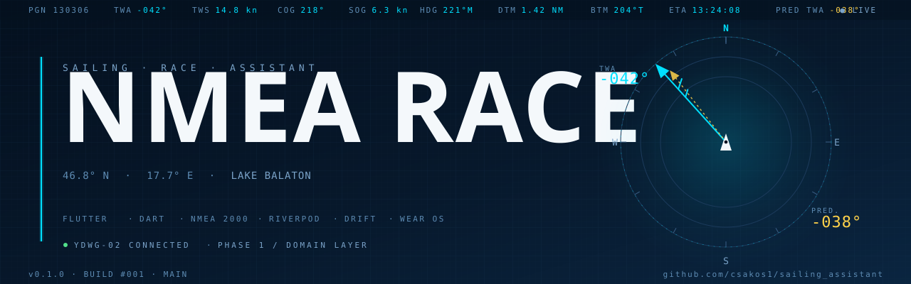

<p align="center">
  
</p>

<h1 align="center">Foretack</h1>

<p align="center">
  <strong>A sailing race assistant for B&amp;G instruments: phone, Wear OS watch and a private race archive.</strong><br/>
  Predicts the True Wind Angle at the next mark, so you can trim and steer before you round.
</p>

<p align="center">
  <a href="https://github.com/csakos1/sailing-assistant/actions/workflows/ci.yml">
    
  </a>
  
  
  
  
  <a href="LICENSE"></a>
</p>

<p align="center">
  <a href="#what-it-does">What it does</a> ·
  <a href="#architecture">Architecture</a> ·
  <a href="#getting-started">Getting started</a> ·
  <a href="#development">Development</a> ·
  <a href="ARCHITECTURE.md">Full architecture →</a>
</p>

---

## Overview

Foretack reads live data from the boat's B&amp;G NMEA 2000 network through the
**B&amp;G Vulcan 7R** chartplotter, which re-broadcasts it as NMEA 0183 over its
own WiFi hotspot (TCP, port 10110). No extra gateway hardware is needed. From
that stream the phone computes, about once a second, what the chartplotter does
not show well: the **predicted TWA at the next mark**, the bearing, distance,
ETA and course correction to the active mark, and the target speed from the
boat's polar.

The **phone is the brain**, the **Wear OS watch is the glanceable display** on
deck, and a **private web archive** keeps every race since 2021. Position,
heading, wind and speed come from the instruments, not the phone GPS.

Everything assumes that **debugging on the water is impossible**: every
calculation can be replayed from recorded NMEA 0183 logs on the couch.

<sub>A personal project, used in tour-style regattas on <b>Lake Balaton, Hungary</b>.</sub>

---

## What it does

### Phone (Android)

Three tabs — **Races · Instruments · Race log**.

- **Instruments without a race.** The app looks for the boat when it opens and
  shows live boat speed, target speed (% of polar), VMG, TWA and TWS even when
  no race is running. Data is recorded only during a race.
- **Scheduled races.** A race can have a start time and a start point. On race
  day the instruments guide you to the start point like to a mark; at the start
  time the race **starts by itself** (also retroactively, if the app opened
  late).
- **Racing view.** Predicted TWA at the next mark (with confidence), course
  correction, current TWA, distance, ETA, target speed and VMG.
- **Automatic mark rounding and finish**, with a manual "mark rounded" button.
- **Background engine** in a foreground service: keeps running with the screen
  off, survives a swiped-away app, stops itself after 10 minutes without the
  boat (outside a race).
- **Warnings** for a lost connection, lost GPS, unsynced time, suspect heading,
  missing polar, short wind history and shallow water.
- **Safety map** of restricted areas and fixed navigation marks.
- **Race log** by year with totals, **post-race analysis** of the mark
  predictions, and a shareable track image.
- **Web sign-in**: scan the archive's QR code and confirm with a fingerprint.

### Watch (Wear OS)

A downsampled view of the phone's state over the Wearable Data Layer: next
mark, speed, mark rounding (with a "mark rounded" button), haptic confidence
and shallow-water alerts. It never sees the raw NMEA stream.

### Web archive (private)

A Flutter web app over a small Dart server, behind sign-in:

- every race since 2021 — telemetry races uploaded from the phone and manual
  races imported from the old spreadsheet, with tracks from the voyage recorder;
- results (class, overall, monohull), official start and finish times;
- season statistics and **polar performance** (time spent at % of polar);
- a full export (databases + JSON) as a single archive;
- **QR + fingerprint sign-in** through the phone app; an owner who edits and
  read-only crew members who only view.

---

## Architecture

Clean Architecture, four layers, dependencies always point inward. The full
document is **[`ARCHITECTURE.md`](ARCHITECTURE.md)** — the project's north star;
decisions are recorded as ADRs in [`docs/decisions/`](docs/decisions/).

```
┌─────────────────────────────────────────────────────────────┐
│  PRESENTATION  Flutter UI (phone · watch · web)             │
└─────────────────────────────┬───────────────────────────────┘
┌─────────────────────────────▼───────────────────────────────┐
│  APPLICATION  Riverpod providers · engine host · bridges    │
└─────────────────────────────┬───────────────────────────────┘
┌─────────────────────────────▼───────────────────────────────┐
│  DOMAIN       Pure Dart · entities · use cases · interfaces │
└─────────────────────────────▲───────────────────────────────┘
                              │ implements
┌─────────────────────────────┴───────────────────────────────┐
│  DATA         NMEA 0183 TCP · parsers · race engine · Drift │
└─────────────────────────────────────────────────────────────┘
```

- `domain` has **no** Flutter, `dart:io` or platform dependency.
- Repositories are interfaces in `domain`, implemented in `data`, swapped with
  Riverpod overrides in tests.
- The race engine runs in a separate isolate (foreground service) and sends
  snapshots to the UI; the same engine is driven by the replay tests.
- Parsing, business logic, persistence and UI never share a file.

### Tech stack

| Concern | Choice |
|---|---|
| UI | Flutter 3.41 (stable) — phone, Wear OS, web |
| Language | Dart 3.11+ (sealed classes, pattern matching, pub workspaces) |
| State | Riverpod 2.x |
| Local DB | Drift (SQLite) |
| Server | `shelf` + `shelf_router`, AOT-compiled Dart, SQLite |
| Monorepo | Melos + pub workspaces |
| Lints | `very_good_analysis` |
| CI | GitHub Actions — analyze, format check, tests on every PR and on `main` |

---

## Repository layout

```
sailing-assistant/
├── apps/
│   ├── phone/             # Android app: race UI, race engine host, web sign-in
│   ├── watch/             # Wear OS app
│   ├── web/               # Flutter web: the race archive
│   └── web_server/        # Dart server + CLIs (import, sign-in admin, GeoIP)
├── packages/
│   ├── domain/            # Pure Dart: entities, value objects, use cases
│   ├── data/              # NMEA 0183 client and parsers, race engine, Drift DB
│   ├── shared/            # Result<T, E>, small utilities
│   ├── foretack_ui/       # Shared design system and widgets (phone + web)
│   ├── race_archive_api/  # HTTP contract of the archive: DTOs, codecs
│   └── wearable_bridge/   # Phone → watch transport (Wearable Data Layer)
├── tools/
│   ├── nmea_replay/       # Replays a recorded NMEA 0183 log as a TCP server
│   ├── sample_logs/       # Logs for replay tests and demos
│   ├── race_analyzer/     # Post-race analysis of the mark predictions
│   ├── prediction_probe/  # Replay harness for the prediction model
│   ├── legacy_race_log/   # Converts the old spreadsheet race log to JSON
│   └── dev/               # Local web development (Caddy, phone stand-in)
├── deploy/                # VPS deploy, backups, crew APK release
├── docs/                  # ADRs, design spec, on-device test guide, plans
└── ARCHITECTURE.md        # The north star — read this first
```

---

## Getting started

Verified on Arch Linux with physical devices (a Pixel phone and a Galaxy Watch).

### Prerequisites

- Flutter SDK 3.41 (stable) — `flutter doctor` should be green for Android.
- JDK 17 and the Android SDK (platform tools, an SDK platform, build tools).
- Melos: `dart pub global activate melos`.

### Bootstrap

```bash
git clone https://github.com/csakos1/sailing-assistant
cd sailing-assistant
melos bootstrap
```

### Run on the phone and the watch

```bash
cd apps/phone && flutter run --release     # Pixel over USB or wireless ADB

adb connect <watch-ip>:<port>              # watch over wireless ADB
cd apps/watch && flutter run --release
```

The phone and the watch share the same application ID, which the Wearable
Data Layer needs to deliver messages (ADR 0018, [`ARCHITECTURE.md`](ARCHITECTURE.md) §10).

### Replay a race on the couch

```bash
# 1. Replay server emulating the Vulcan's WiFi output (port 10110)
dart run tools/nmea_replay/bin/nmea_replay.dart \
  tools/sample_logs/home_test_sample.nmea --loop

# 2. Point the phone at it through adb (no IP address, no firewall rule)
adb reverse tcp:10110 tcp:10110
cd apps/phone
flutter run --release --dart-define=FORETACK_GATEWAY_HOST=127.0.0.1
```

Build without `--dart-define` before going on the water, otherwise the app looks
for `127.0.0.1` instead of the Vulcan. The full on-device checklist is in
[`docs/testing/engine-session-on-device.md`](docs/testing/engine-session-on-device.md).

### The web archive locally

A server, the web app and a local Caddy in three terminals; a script in
[`tools/dev/`](tools/dev/) stands in for the phone during sign-in. See
[`ARCHITECTURE.md`](ARCHITECTURE.md) §20 and
[`deploy/README.md`](deploy/README.md) §14.

---

## Development

```bash
melos run analyze        # dart analyze --fatal-infos --fatal-warnings
melos run format-check   # dart format --set-exit-if-changed
melos run test           # test:dart (pure Dart packages) + test:flutter
```

Drift code is generated per package:
`(cd packages/data && dart run build_runner build)`.

**Git hooks.** Two pre-commit hooks exist; git uses one `core.hooksPath` at a
time:

- `deploy/git-hooks` — secret scan (gitleaks) and forbidden file types. **Use
  this one**, because the repository is public
  ([`deploy/README.md`](deploy/README.md) §1.2).
- `.githooks` — runs `analyze` and `format-check` before every commit.

**Commits** follow Conventional Commits in English, with a body that explains
what changed and why. `main` is always green: work happens on branches and
lands through pull requests.

---

## Testing

| Layer | Approach |
|---|---|
| Domain | Pure unit tests, no mocks; target ≥ 95 % coverage |
| Data | Parser and repository tests with in-memory Drift |
| Engine | **Replay tests**: a recorded NMEA 0183 log runs through the real pipeline and engine (rounding, finish, scheduled start) |
| Application / UI | Riverpod provider tests with overrides, widget tests on the screens |
| Server / web | Endpoint, access-rule and import tests; widget tests |
| On device | A manual checklist for what unit tests cannot see: screen off, swiped app, process death |

The replay tests are the main quality gate: the boat is rarely available, so
every regression has to be catchable from the couch.

---

## Deployment

- **Web archive:** the server and the web app are built on the development
  machine and deployed to a small VPS behind Caddy (HTTPS), with nightly
  backups pulled to the developer's machine.
- **Crew app:** the same phone app for everyone; a release APK is published
  through the archive, and the server decides who is owner and who is crew.

Everything is in [`deploy/README.md`](deploy/README.md). Configuration and
secrets stay out of the repository.

---

## Status

The phone app, the watch app and the web archive are in use. Open ideas and
postponed work are listed in [`docs/deferred.md`](docs/deferred.md); every
design decision is an ADR in [`docs/decisions/`](docs/decisions/).

This is a personal project. Issues and questions are welcome.

---

## License

[MIT](LICENSE) © 2026 Csaba Ákos

## Acknowledgements

- **[DB-IP](https://db-ip.com)** — IP geolocation data (CC BY 4.0) used in the
  archive's sign-in history.
- **[OpenStreetMap](https://www.openstreetmap.org/copyright)** contributors —
  map tiles.
- The Lake Balaton sailing community.

---

<p align="center">
  <sub>Built for tour-race regattas on Lake Balaton ⛵</sub>
</p>
